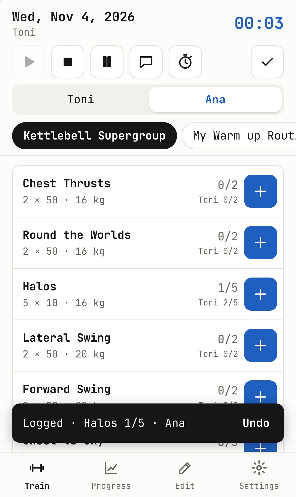
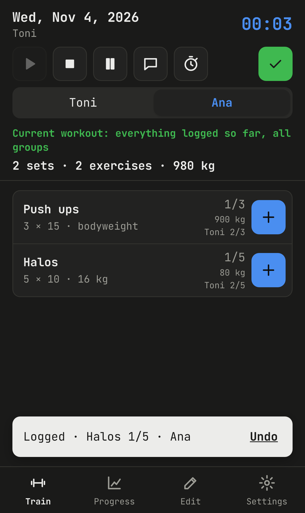
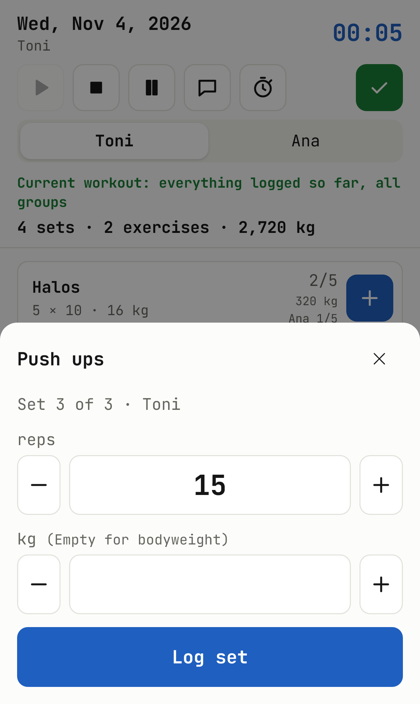
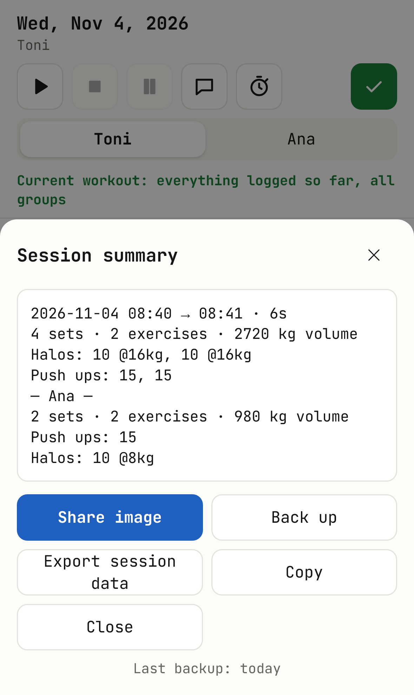
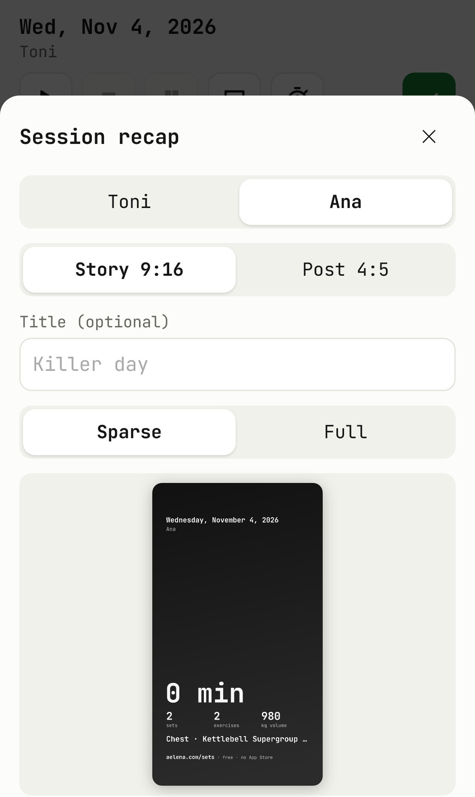
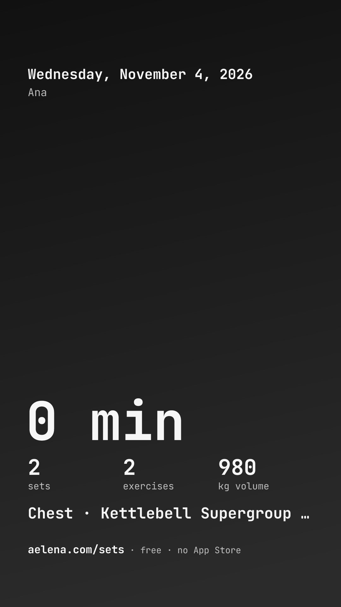
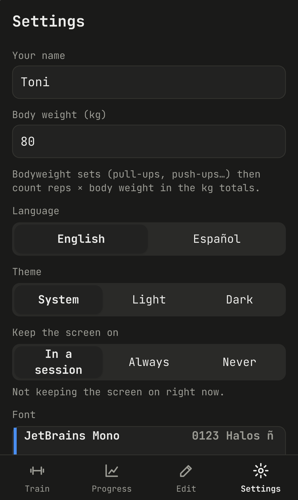

# Sets

A small, opinionated web app for logging training sets at the gym or at home. It installs on an iPhone from Safari (no App Store), works offline, and keeps every set on the phone. You can follow each exercise and muscle in the app, share a recap image, or export everything to Excel.

Built for one person's routine first. Anyone can use it; whatever you log stays in your own browser.

Live at **https://aelena.com/sets/**.

## Screenshots

iPhone 15, light and dark, with a training partner switched on.

<p>
  
  
  
  
</p>
<p>
  
  
  
</p>

## Install on an iPhone

1. Open **https://aelena.com/sets/** in **Safari** (or your own deployment; it must be served over HTTPS, see [Deploy](#deploy)).
2. Share → **Add to Home Screen**.
3. Open it from the home screen. From then on it runs full screen and offline, with its own icon and launch screen.

Updates arrive on their own: open the app, and if nothing changed, close it and open it again.

## Training

### Groups and exercises

- **Groups** sit as tabs at the top of the Train screen; exercises show in the group's order. Reorder groups in **Edit → Groups** (↑ / ↓); the "Cardio & more" tab always stays last.
- **One exercise, one history.** An exercise has a target (sets × reps, or sets × seconds for planks and hangs), an optional weight (empty for bodyweight), an optional *per side* flag, muscles, a description and a video link. If it is in two groups it is still one exercise with one history.
- **Names in English and Spanish.** Exercises, groups and activities carry a Spanish name too; the app shows the one for its language, the Excel export has both.

### Logging a set

- Tap **+**: reps and kg are prefilled from your last set of the current workout, or from the target. Confirm, or adjust and confirm. **Undo** is offered right after; any set can be edited or deleted.
- **Counters** (`2/5`, green when reached) show the **workout in progress**: the running timed session, or the loose sets not completed yet. They go back to 0 when a workout is finished.
- **Last time:** under each exercise, `last: 2×10 · 9 @16kg · Wed` (or `· today`), the sets of the most recent finished workout.
- **Personal bests:** a small flame marks a set no earlier set matched on both weight and reps (or seconds). Per exercise, from its 12th training day: before that nearly every set would be a best.
- **Current workout view:** the ✓ in the top bar lists everything in the current workout from any group in one list, for days that mix groups, with the **kg tally** so far: per exercise on each row, and `4 sets · 2 exercises · 960 kg` at the top.
- **Body weight:** set yours in **Settings → Body weight (kg)** and bodyweight sets (pull-ups, push-ups, dips: kg left empty) count reps × body weight in every kg total: the tally, the summary, the recap image, weekly volume, the volume chart and the Excel export. The body weight of the day is kept on each set, so an old session does not change when you do. Sets logged before a body weight was set stay out of the totals; max kg charts only count weight added.
- **Lifts per rep:** for compound moves, **Edit → exercise → Lifts per rep** says how many times one rep lifts the weight (a 3-phase curl: 3; a superseries: its moves). Every kg total multiplies by it. The value is stamped on each set when logged, like the body weight; sets from before use the exercise's current value.

### Training with a partner

- **Settings → Partner → Train with a partner**, with their name and body weight. The Train screen then shows a switch with the two names: every set is logged for whoever is selected, and the counters, chips, *last* and personal bests are that person's (the other one's count shows small under it, `Ana 1/3`). The partner's next set is prefilled from their own last set.
- The session, its time and rests are shared. On ■ or Complete the summary gets a block for the partner (`— Ana —`, their sets, exercises and kg), and **Share image** offers one recap per person, with **Share both images** sending the two through one share sheet.
- The partner's sets live in a table of their own: nothing in your history, charts, bests or Overview ever counts them. They do travel in backups and session exports, and get their own sheet in the Excel export.

### Sessions, timed or not

- **Timed:** ▶ starts a session, ■ stops it. A session left running closes itself after two hours without activity, at its last set.
- **Untimed:** anything logged without ▶ (at home between meetings, a run in the morning) stays loose, and a **Complete** bar offers to file it into that **day's untimed session**: one per day, with the same summary, recap image, export and history as a timed one, and the day instead of a duration. Complete again later the same day and it joins the same untimed session.
- **Bundling:** when you stop a timed session and something was logged outside it that same day (the morning run, a few kettlebell sets), the summary offers **Add to this session** so the day records as one. The session keeps its real start, end and rests, and its **training time** becomes the session's own duration plus the bundled activities' minutes (`1h 05m · total 1h 50m`), used by the summary, the recap image ("gym 1h 05m + Running 45 min" under the total), History, the Overview and the exports. **Keep separate** leaves it for the Complete bar.
- **A new day starts at 0:** opening the app on a new day, coming back to it, or keeping it open past midnight completes any loose rows from earlier days into their own untimed sessions.
- **Rest timer:** in a session, the pause button turns the screen into a big timer with a stop button; rests are counted and summarised (count, total, average, longest). Without a session running it is disabled, like ■.
- **Stopwatch:** the stopwatch button opens a full-screen stopwatch, digital or analog, with start / stop, laps and reset, so you need not leave for the phone's. It keeps running when closed (the button turns orange) or when the app reloads, keeps the screen on while it runs, and records nothing.
- **Notes:** the speech bubble opens a notes box tied to the session, or to the day. To dictate, use the microphone on the iPhone keyboard.
- **Screen stays on:** **Settings → Keep the screen on**: in a session (default: while a timed session or a rest runs), always while the app is open, or never. Screen Wake Lock; iPhone home-screen apps need iOS 18.4+. Settings shows whether it is active.

### Cardio & more

Running, Rowing, Gym Bike and Sprints have their own tab; **Other activity…** takes any name and keeps it for next time.

- Running, rowing, bike: duration, distance and pace (min/km). Fill any two and the third is worked out (`30 min` at `6'` → 5 km). Pace accepts `6`, `6:00`, `6'` or `6'30"`.
- **Sprints:** seconds or metres, or both (`70 s · 400 m · 2:55/km`). Nothing is prefilled, and sprints never show as stale.
- Activities appear in the summary, the recap, History, Progress (minutes, km, pace) and their own Excel sheet. Rename or remove them under **Edit → Activity**.
- **Import a run (GPX)** (0.17.0): the run your watch or running app recorded (Apple Watch through an exporter such as HealthFit or RunGap, Strava, Garmin Connect, Nike Run Club, Runkeeper...), exported as GPX and picked from Files. The sheet shows the track's shape, distance, moving time (stops and auto-pause gaps left out), pace, climb (rises under 3 m are GPS noise) and the start and end times, lets you log it as Running or any other activity, and ticks **Add to that day's session** when the day has a finished timed session. The run is logged at its own date and time, so a run from last week lands on last week; the label carries the climb (`30 min · 5.2 km · 5:46/km · ↑42 m`), the recap image draws the route, and the route travels with backups, session exports and the Excel `ascent_m` column. The same run twice is refused. Sets tracks nothing itself: a web app on an iPhone cannot read GPS with the screen locked, so the recording stays with the tools built for it.

## Progress

- **Overview** (opens first):
  - **Since you last trained**, per muscle: amber after a week, stale after two. Exercises without muscles (kettlebells stay kettlebells) count under their group; activities as cardio, sprints excepted.
  - **Sessions per week** over 12 weeks with the 4-week average and training days, and a **weeks-in-a-row** streak (weeks with 2+ training days) with the best run.
  - **Session length**, **sets per muscle per week** (small multiples on one scale, 8 weeks; a set counts 1 for its main muscle, ½ for the others), **weekly volume**, **weekly cardio** (minutes, km), **rest per session** and **when you train** (morning, midday, afternoon, night).
  - Every chart has a table view.
- **Charts:** per exercise or activity: volume, heaviest weight, total reps or seconds, sets per day; minutes, km and pace for activities.
- **Calendar:** a month view, Monday first. Days with a session are blue squares with white numbers in both themes; days with only loose sets are outlined. Tap a day to see it.
- **History:** day by day, sessions (timed and untimed) with their summary, sets, activities and notes; any finished session can make its recap image again.

## Sharing and exporting

- **Session summary:** after ■ or Complete, stored as plain text: time or day, sets, exercises, activities, volume, rests and every exercise's sets; then the partner's block when training with one.
- **Recap image for Instagram:** from the summary or any session in History. A 1080×1920 story or 1080×1350 post, **Sparse** (date, duration, sets, volume, muscles trained, personal bests) or **Full** (plus every exercise), over a gradient, a bundled gym photo or one picked from Photos, with an optional title of your own ("Killer day") printed big under the date and kept with the session. **Share** opens the iOS share sheet, Instagram included. Every recap prints `aelena.com/sets`.
- **A run after the gym:** when a timed session is over and you log something later that day outside it (a run on the way home), the bar above the groups offers **Add to today's session** next to **Complete**: the run joins the session, the summary and total time are rebuilt, and **Share image** makes the recap again with it. The same is offered on the session in History while the day still has loose items.
- **Session data:** **Export session data** saves the session's raw JSON through the share sheet (Files, the Google Drive app, AirDrop). With a Google client ID set up, **Upload to Google Drive** puts it straight into a `Sets` folder, and Settings can do it after every session. See [Google Drive](#google-drive).
- **Excel (.xlsx):** one row per set, plus sheets for activities, sessions and notes. A real workbook, not a CSV, so Excel in Spanish and other European locales opens it correctly.
- **Exercise config (JSON):** export your groups and exercises, edit them on a computer, import them back (merge or replace). See [The config file](#the-config-file).
- **Full backup (JSON)** and restore. The main screen and the summary remind you when the last backup is more than a week old.

## The built-in library

The app ships with groups to start from, each exercise with a short form cue in English and Spanish, its muscles and a link to a YouTube search for good form. Weights are placeholders.

- **Starter:** Kettlebell Supergroup and My Warm up Routine (with the Push-up Touch Superseries: 29 push-ups with touches and climbers in between).
- **Classic:** Biceps, Triceps, Shoulders, Chest (bench, incline and decline press, dumbbell and incline dumbbell press and flyes, cable crossovers, pectoral fly (pec deck), seated chest press, pullover, chest dips; joined to your own chest group when you have one), Leg Day (with hip thrust, glute bridge, goblet, front and hack squats), Core, Back. A review in 0.11.0 added the common staples each group was missing (EZ-bar and incline curls, kickbacks, Arnold press, rows, hollow hold, Pallof press...); 0.12.1 added lateral crunches, scissor kicks and cross scissors to Core.
- **Push-up variations** (wide, incline, decline, archer, pike, clap, Hindu, Spiderman) and burpees, added to a *Functional* group when there is one, as their own group otherwise.
- **Bodyweight** (0.15.0): the seven-column chart, abs to chest: sit-ups, reverse crunches, flutter kicks, turning kicks, plank jump-ins, donkey kicks, jump knee tucks, close-grip push-ups, doorframe rows, superman, star plank, plank rotations, chest squeezes, pseudo planche push-ups, and the staples it shares with other groups.
- **Military Calisthenics** (0.15.0): the 28-day challenge in order (push-ups, air squats, plank, lunges, pull-ups, dips... burpee pull-ups) plus what the 30-day plan adds (shoulder taps, pike hold, high knees, reverse lunges, push-up hold, bear crawl, hip openers).
- **Kegels · Men** and **Kegels · Women**, the last groups: quick squeezes, long holds, elevator, reverse Kegels and bridge with Kegel, cued for each body, with their own history and the *Pelvic floor* muscle. 0.15.0 adds the pelvic-floor posters: pelvic tilts, bird dog, clamshells and side-lying leg lifts for both; knee to chest, leg lifts, seated marches, ball squeeze, fire hydrants, cat-cow, reverse plank and the stretches for men; heel slides, wall sit, seated and standing contractions, marching, modified plank, belly breathing, happy baby and child's pose for women.
- **Every target has at least 4 sets** since 0.15.0: a pack applied once sets any exercise with fewer, your own included, to 4; new exercises start at 4.

### Library updates never touch your data

Built-in content arrives as *packs*, each applied once per phone and only ever added:

- an exercise you already have (same id or same name) is reused, never changed;
- a built-in group whose name you already use is added next to yours, e.g. "Back (classic)"; a pack can also append exercises to the end of an existing group;
- descriptions, links, muscles and Spanish names are only filled in where an exercise has none;
- nothing is deleted, renamed or overwritten, and logged sets always keep pointing at their exercise.

One-time curation steps (`curate-1` to `curate-3`) named hand-built exercises properly, guarded by their exact original id and name, so they do nothing on any other phone and never undo a later edit; a never-used built-in duplicate folds into yours. Restoring an older backup applies only the packs added since.

## Versions

After an update, the first time the app opens it shows the new version and a few lines on what changed (from `src/lib/changelog.js`), with an OK button; skipped versions are listed too (up to three). The version also shows in **Settings → About**. Each release bumps it: the middle number for new features, the last one for fixes; releases are tagged in git (`v0.9.0`).

## Settings

Your name and body weight, the training partner (name, body weight), English or Español, light / dark / system, five bundled monospace fonts (JetBrains Mono by default, IBM Plex Mono, Victor Mono, Fira Code, Space Mono), keep the screen on, Google Drive, exports and imports, backup and restore, whether the phone keeps the app's storage permanently, and **Share Sets**: a QR code for `https://aelena.com/sets/` to show someone at the gym, with the link and the QR as an image for the share sheet. The same QR is in [docs/sets-qr.png](docs/sets-qr.png); `npm run qr` regenerates both if the address ever changes.

## Your data

Everything lives in the browser's IndexedDB on the device: no account, no server, no sync.

- At start-up the app asks the browser to keep its storage permanently. Home-screen apps on iOS are spared Safari's 7-day clean-up of website data, but **deleting the app from the home screen deletes its data.**
- So back up. **Settings → Full backup** opens the iOS share sheet: save the file to iCloud Drive or Files.
- **Settings → Restore full backup** replaces everything on the device with a backup file.

## The config file

Groups and exercises can be written by hand and imported in **Settings → Import exercise config**. See [`examples/config.example.json`](examples/config.example.json).

```json
{
  "format": "exercise-tracker/config",
  "version": 1,
  "exercises": [
    { "id": "halos", "name": "Halos", "names": { "es": "Halos" }, "sets": 5, "reps": 10, "kg": 16 },
    { "id": "plank", "name": "Plank", "names": { "es": "Plancha" }, "type": "time", "sets": 3, "seconds": 60, "muscles": ["core"] }
  ],
  "groups": [
    { "name": "Kettlebell Supergroup", "exercises": ["halos", { "name": "Lateral Swing", "sets": 2, "reps": 50, "kg": 20 }] },
    { "name": "Core", "names": { "es": "Core" }, "exercises": ["Plank", "Halos"] }
  ]
}
```

- A group entry can be an exercise **id**, an exercise **name**, or a full exercise object. Names are matched case-insensitively against the file and against what is already on the phone, so the same exercise in two groups stays one exercise.
- Exercise fields: `name` (required, English), `names.es`, `type` (`reps` default, or `time`), `sets`, `reps` or `seconds`, `kg` (omit for bodyweight), `lifts` (lifts per rep for compound moves, omit for 1), `perSide`, `muscles` (`chest`, `back`, `shoulders`, `biceps`, `triceps`, `forearms`, `core`, `glutes`, `quads`, `hamstrings`, `calves`, `pelvicFloor`, `fullBody`), `desc`, `link`. `id` is optional: one is derived from the name.
- A description written as `EN: …` and `ES: …` lines shows the line for the app's language.
- **Merge** adds and updates groups and exercises and keeps the rest. **Replace** makes the groups exactly those in the file. Exercises no longer used are archived, never deleted, so logged sets keep their names.

## Excel export

Sheet `sets`, one row per set:

| date | time | exercise | exercise_es | group | set_no | reps | seconds | kg | body_kg | lifts | volume_kg | session | exercise_id |
|---|---|---|---|---|---|---|---|---|---|---|---|---|---|

`set_no` counts within the day and exercise; `body_kg` is the body weight kept on a bodyweight set; `lifts` the lifts per rep (1 unless set); `volume_kg` is reps × kg × lifts, or reps × body_kg × lifts for a bodyweight set. A `partner sets` sheet with the same columns appears when a training partner has logged sets. Sheets `activities` (date, time, activity, activity_es, minutes, km, pace_min_km, ascent_m, notes, session), `sessions` (date, start, end, minutes, summary) and `notes` come with it.

## Google Drive

Uploading straight to Drive needs an OAuth client ID that you own (the share-sheet export works without it):

1. In [Google Cloud console](https://console.cloud.google.com/) create a project and enable the **Google Drive API**.
2. **OAuth consent screen**: External; add the scope `.../auth/drive.file` and yourself as a test user.
3. **Credentials → Create credentials → OAuth client ID → Web application**:
   - Authorized JavaScript origins: `https://aelena.com` (your host)
   - Authorized redirect URIs: `https://aelena.com/sets/` (the app's exact URL)
4. Paste the client ID in **Settings → Google Drive** and tap **Connect Google Drive**.

The app uses the `drive.file` scope: it can see and create only its own files, in one `Sets` folder. Sign-in is a full-page redirect (popups are unreliable in home-screen apps) and the token lasts an hour; after that the next upload asks you to sign in again. The client ID can also be baked in at build time as `VITE_GOOGLE_CLIENT_ID`.

## Recap backgrounds

Put portrait photos (about 1080×1920, `.jpg`, `.jpeg`, `.png` or `.webp`, under 1 MB each) in [`src/assets/backgrounds/`](src/assets/backgrounds/) and rebuild. Each file becomes a background choice and is cached for offline use. The app draws all text itself and darkens the photo towards the bottom, where the numbers sit, so the photos should carry no text.

The bundled set was generated from the prompt in [`docs/background-prompt.md`](docs/background-prompt.md); the full-size originals stay out of git (`img/`).

## Development

Vite + Svelte 5, Dexie (IndexedDB), uPlot, SheetJS, `vite-plugin-pwa`. No backend.

```bash
npm install
npm run dev          # http://localhost:5173, also on the LAN (--host)
npm test             # unit tests (vitest + fake-indexeddb)
npx playwright install webkit chromium   # once
npm run test:e2e     # builds, serves the build, runs on iPhone 15 profiles (WebKit and Chromium), 2 workers
npm run test:recaps  # renders a fixture session over every background into recap-samples/
npm run build        # dist/, with service worker, icons and iOS launch images
```

To try it at phone size in a desktop browser: open the dev server, then DevTools → device toolbar → iPhone. WebKit under Playwright is the closest thing to iOS Safari on Windows, but it is not the same: check on the real phone before relying on it.

Project layout:

```
src/lib/        repo (all DB operations), db (Dexie schema, versions 1-5), packs (add-only library updates),
                seed / catalog / catalog2 (built-in library and curation), config, history (last batch, bests,
                open workout), overview (Overview figures), summary, recap / recapImage, activity, gpx (GPX
                reader, distance, moving time, climb, track fitting), drive, sessionFiles, wakeLock, export,
                i18n, names, settings
src/views/      Train, Progress, Edit, Settings
src/components/ ExerciseRow, LogSheet, ActivitySheet, GpxSheet, Route, NotesSheet, RestTimer, SummaryModal,
                RecapSheet, Overview, MuscleWeeks, Calendar, Chart, ExerciseForm, Splash, Sheet, Toast, TabBar, Icon
tests/unit      logic and repository tests
tests/e2e       Playwright flows at iPhone size; recap.spec.js renders the recap samples
```

## Deploy

The build is static and uses relative paths, so it works from any HTTPS static host, including GitHub Pages under `/<repo>/`. `.github/workflows/pages.yml` runs the unit tests, builds and publishes on every push to `main` once the repository has Pages enabled with "GitHub Actions" as the source.

## Roadmap

- **Weight progression per set** (50 kg, then 60, then 70): logged sets already carry their own weight; the plan would let `kg` be a list, one value per set. The UI for editing it is still open.
- Imperial units (lb, miles) as a setting.
- Live run tracking (GPS while the app is open, screen kept on) was looked at and not built: iOS suspends a web app when the phone locks, and the phone's pedometer and Health data are out of reach of the web. Importing the GPX of the app that did record it covers the use.

## License

MIT
